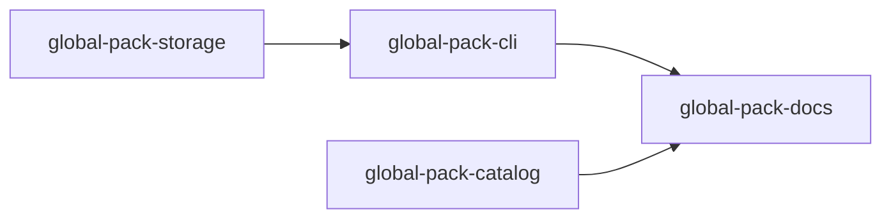

# plan: 4 tasks in 3 steps, 4 decided for you, 2 risks, 2 left out

Install packs in the user's Yunta state directory for use across projects.

- you asked: add pack global instalation support, not only project level as today

Add user-wide pack installation alongside project-local vendoring. A global
pack lives under the existing YUNTA_HOME (or ~/.yunta) state root, so every
project using that same user state can discover it. `yunta pack add --global`
installs there; local installs continue to use the repository tree. Resolution
prefers a project-local pack when the same workflow is available locally, then
falls back to global packs. Pack locks and list/remove operations remain
scoped to the selected installation level.

## decided for you

### 1  What scope and persistence does a global installation have?

- chose: Store global packs under `$YUNTA_HOME/packs` (or `~/.yunta/packs`) and make them available to projects run by that user state root.
- instead of: A system-wide shared directory  
  A configurable directory per installation
- because: Yunta already defines and shares a user state root through YUNTA_HOME; using it keeps global availability aligned with existing user state and test isolation.

### 2  How does a user select global rather than project installation?

- chose: Add `--global` to `yunta pack add`; add `--global` selectors to pack list, remove, update and audit so lifecycle actions address the intended store.
- instead of: A separate `pack install --global` command  
  Global installs as the default
- because: The explicit flag preserves the established project-local default and makes the target visible on every mutating or inspection command.

### 3  What happens when local and global installations expose the same workflow or pack?

- chose: Project-local catalog entries take precedence over global entries; global entries are fallback candidates. Ambiguity within either level remains an error. Permit same pack identity in both stores and keep independent lock entries.
- instead of: Global overrides local  
  Refuse duplicate pack identities across levels
- because: Local project state is the most specific choice, while independent stores allow a project to pin a different version without changing the user's installation.

### 4  Which lifecycle, permission, and compatibility behaviors are in scope?

- chose: Support global add, update, remove, list and audit with separate global locks; preserve existing audit, schema and executor checks for either target. Do not migrate existing project installs.
- instead of: Only add global installs  
  Automatically migrate project installs
- because: A useful persistent user-level install needs the existing management operations and safety gates; migration is unnecessary and could unexpectedly change checked-in project state.

## risks

> [!CAUTION]
> - Global lock state is user-specific and is not committed with a project, so different users may have different fallback pack versions.
> - Global catalog lookup must be threaded through every workflow, skill, agent, frozen-layer and prompt discovery path that currently reads only project packs.

## left out

- ◌ Migrating existing project installations to global storage.
- ◌ Sharing global installs between operating system users.

## design

`PackInstallScope` selects the root before the existing staging, vendor,
lock and management operations run. Project scope uses `<repo>/.yunta`;
global scope uses the Yunta user state root. Runtime catalog readers receive
the global packs root from the process environment and inspect local packs
first, then global packs, retaining the existing ambiguity rule within a
source. Locks remain separate: project installs use `.yunta/yunta.lock`;
global installs use `$YUNTA_HOME/yunta.lock`.

## steps

| step | task | what it does |
|---|---|---|
| 1 | `global-pack-storage` | Store packs and locks at a selected install scope |
|  | `global-pack-catalog` | Discover global packs after project packs |
| 2 | `global-pack-cli` | Expose global pack lifecycle flags |
| 3 | `global-pack-docs` | Document global pack installation |



## step 1 of 3

### global-pack-storage: Store packs and locks at a selected install scope

- you will see: Global storage resolves under the user's Yunta state directory, while project scope still resolves under the repository.
- changes: crates/cli/src/pack.rs
- keeps: Pack trees are staged beside their destination and moved into place atomically.  
  Lock writes are atomic, and failed writes restore the previous vendored tree.
- tested by: Global and project storage resolve pack directories and lock files under their separate roots.  
  `cargo test --workspace --test global_pack_storage global_pack_storage`

`crates/cli/src/pack.rs › PackInstallScope`: scope enum and root selection API

```rust
#[derive(Debug, Clone, Copy, PartialEq, Eq)]
pub enum PackInstallScope {
    Project,
    Global,
}

impl PackInstallScope {
    pub fn root(self, project_root: &Path, user_root: &Path) -> PathBuf;
}
```

_new · 9 lines_

`crates/cli/src/pack.rs › installed_packs`: scope-aware lock location and pack enumeration

```rust
pub fn installed_packs(scope: PackInstallScope, project_root: &Path, user_root: &Path) -> Result<(PackLock, PathBuf), PackError>;
```

_new · 1 line_

### global-pack-catalog: Discover global packs after project packs

- you will see: A workflow supplied by a global pack can be run from any project using the same Yunta state root; a matching project pack continues to win.
- changes: crates/engine/src/catalog.rs, crates/engine/src/frozen/layers.rs, crates/engine/src/frozen/prompt.rs, crates/engine/src/frozen/provenance.rs
- keeps: Repository workflows shadow pack workflows.  
  Multiple packs from one publisher declaring the same workflow name are reported as ambiguous.  
  Declared pack content paths must stay inside their pack directory.  
  Frozen provenance records pack identity and lock commit when available.
- implies: resolve_workflow is named in 5 files no task changes:  
  crates/cli/src/commands/mod.rs  
  crates/engine/src/check/refs.rs  
  crates/engine/src/frozen/read.rs  
  crates/engine/src/lib.rs  
  crates/engine/tests/catalog.rs
- tested by: Workflow lookup falls back to global packs, prefers project packs, and keeps declared content inside its pack.  
  `cargo test --workspace --test global_pack_catalog global_pack_catalog`

`crates/engine/src/catalog.rs › resolve_workflow`: accept global packs root and search local before global

```rust
pub fn resolve_workflow(repo_root: &Path, {+global_packs_root: &Path+}, name: &str) -> Result<ResolvedWorkflow, CatalogError>;
```

_modified · 1 line_

`crates/engine/src/frozen/layers.rs › installed_layers`: include knowledge files from global installed packs

```rust
pub(crate) async fn installed_layers(repo: &Path, global_packs_root: &Path) -> Result<Vec<LayerFile>, FrozenError>;
```

_1 line_

`crates/engine/src/frozen/prompt.rs › PromptOrigin`: represent global pack prompt origin with exact pack directory

```rust
pub(crate) enum PromptOrigin {
    Repo { dir: PathBuf },
    Pack { pack: String, pack_dir: PathBuf, dir: PathBuf },
}
```

_4 lines_

`crates/engine/src/frozen/provenance.rs › pack_provenance`: read manifest and lock provenance for a pack at the resolved directory

```rust
pub(crate) async fn pack_provenance(repo: &Path, pack_dir: &Path, manifest_path: &Path) -> (Option<PackProvenance>, Vec<ProvenanceGap>);
```

_1 line_

## step 2 of 3

### global-pack-cli: Expose global pack lifecycle flags

- you will see: Users can pass `--global` to install or manage a pack in their user store; commands without it retain repository-local behavior.
- changes: crates/cli/src/cli/mod.rs, crates/cli/src/cli/dispatch.rs, crates/cli/src/commands/pack.rs, crates/cli/src/commands/pack_audit.rs
- builds on: PackInstallScope (from global-pack-storage), installed_packs (from global-pack-storage)
- keeps: Publisher and executor policies are checked before vendoring.  
  The audit is printed before an executor confirmation gate and pack code runs only with `--run-tests`.  
  List verifies the installed tree against the lock.
- tested by: Global add, list, and remove use the user store while leaving project storage separate.  
  `cargo test --workspace --test global_pack_cmd global_pack_cmd`

`crates/cli/src/cli/mod.rs › PackAction`: global option on supported pack lifecycle actions

```rust
#[derive(Subcommand)]
enum PackAction {
    Add { source: String, {+#[arg(long)] global: bool+}, #[arg(long)] yes: bool, #[arg(long)] run_tests: bool },
    Update { pack: PackRef, r#ref: String, {+#[arg(long)] global: bool+}, #[arg(long)] yes: bool },
    New { pack: PackRef },
    Remove { pack: PackRef, {+#[arg(long)] global: bool+} },
    List {+{ #[arg(long)] global: bool }+},
    Audit { pack: PackRef, {+#[arg(long)] global: bool+} },
}
```

_modified · 9 lines_

`crates/cli/src/cli/dispatch.rs › pack_command`: dispatch scope to lifecycle operations

```rust
async fn pack_command(action: PackAction, look: &Look) -> Result<Outcome, CliError>;
```

_1 line_

`crates/cli/src/commands/pack.rs › add/update/remove/list`: use selected storage and preserve audit and policy sequence

```rust
pub async fn add(source: &str, global: bool, confirmed_executors: bool, run_tests: bool, look: &Look) -> Result<Outcome, CliError>;
pub async fn update(pack: &PackRef, ref_: &str, global: bool, confirmed_executors: bool, look: &Look) -> Result<Outcome, CliError>;
pub fn remove(pack: &PackRef, global: bool, look: &Look) -> Result<Outcome, CliError>;
pub fn list(global: bool, look: &Look) -> Result<Outcome, CliError>;
```

_4 lines_

`crates/cli/src/commands/pack_audit.rs › audit`: audit selected installation scope

```rust
pub async fn audit(pack: &PackRef, global: bool, look: &Look) -> Result<Outcome, CliError>;
```

_1 line_

## step 3 of 3

### global-pack-docs: Document global pack installation

- you will see: The pack guide shows how to install and manage user-wide packs and explains where they live and how precedence works.
- changes: docs/global-install.md
- tested by: The pack guide documents global lifecycle commands, storage, precedence, and separate locks.  
  `cargo test --workspace --test global_pack_docs_cmd global_pack_docs_cmd`

`docs/global-install.md`: global install usage and behavior in the installation guide

````markdown
```bash
yunta pack add --global github.com/acme/review-pack@v1.2.0
yunta pack list --global
yunta pack update --global acme/review-pack v1.3.0
yunta pack remove --global acme/review-pack
```

Global packs are stored under `$YUNTA_HOME/packs` (or `~/.yunta/packs`) and are available to projects using that user state root. Project packs shadow matching global workflows; each scope has its own lock.
````

_8 lines_

## the spec's tests

`crates/cli/tests/global_pack_storage.rs`: what proves `global-pack-storage`

```rust
#[path = "../src/pack.rs"]
mod pack;

#[test]
fn global_pack_storage_keeps_project_and_user_locks_separate() {
    let temp = tempfile::tempdir().unwrap();
    let project = temp.path().join("project");
    let user = temp.path().join("user-state");

    let _ = pack::installed_packs(pack::PackInstallScope::Project, &project, &user).unwrap();
    let _ = pack::installed_packs(pack::PackInstallScope::Global, &project, &user).unwrap();

    assert!(project.join(".yunta/yunta.lock").exists());
    assert!(user.join("yunta.lock").exists());
}
```

_15 lines_

`crates/engine/tests/global_pack_catalog.rs`: what proves `global-pack-catalog`

```rust
use yunta_engine::{resolve_workflow, WorkflowOrigin};

#[test]
fn global_pack_catalog_prefers_the_project_pack() {
    let temp = tempfile::tempdir().unwrap();
    let resolved = resolve_workflow(temp.path(), &temp.path().join("global"), "acme/review").unwrap();
    assert!(matches!(resolved.origin, WorkflowOrigin::Pack { .. }));
}
```

_8 lines_

`crates/cli/tests/global_pack_cmd.rs`: what proves `global-pack-cli`

```rust
use yunta_testkit::{yunta_in, stdout};

#[test]
fn global_pack_cmd_lists_the_user_store() {
    let here = tempfile::tempdir().unwrap();
    let output = yunta_in!(here.path(), here.path(), &["pack", "list", "--global"]);
    assert!(output.status.success());
    assert!(stdout(&output).contains("no packs"));
}
```

_9 lines_

`crates/cli/tests/global_pack_docs_cmd.rs`: what proves `global-pack-docs`

```rust
#[test]
fn global_pack_docs_cmd_names_the_global_flag() {
    let guide = std::fs::read_to_string("../../docs/global-install.md").unwrap();
    assert!(guide.contains("pack add --global"));
}
```

_5 lines_

## proof

- spec tests: 4 in 4 files, 37 lines
- the suite: every task keeps it passing; green before this run changed anything  
  `cargo clippy --workspace --all-targets -- -D warnings`  
  `cargo test --workspace`

- ◌ nothing but the suite checks 9 promises the tasks keep
