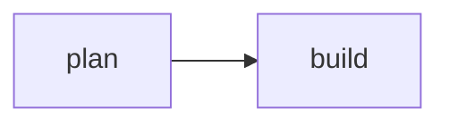

# plan of run 7E5PH4

## run 7E5PH4: ◆ needs you on a decision

The run plans the change, asks before it builds, and builds what you approve.

### what it found

- ✓ **git** commits as Ada <ada@example.com>
- ▲ **forge** github acme/web, reachable
- ◌ **review** no fan-out review

- ▲ A name with a newline in it breaks the line it is printed on.

- ▲ the budget sits under this workflow's usual spend
  - so: the run may stop before it finishes
  - fix: raise `limits.max_tokens_per_run`

### ✗ node `lint`: exit 101

```
line 1
line 2
line 3
```

whole output: `yunta status 7E5PH4 --node lint`

error: unused import  
  --> src/lib.rs:3:5

outside the declared globs:
- `src/main.rs`
- `Cargo.lock` — the lock file

A change **in Markdown**, with `code`.

- an item



`src/lib.rs` — the change

```rust
pub fn greet() {}
```

| step | task | |
|---|---|---|
| ● 1 | `cli-global` | Global and project flags |

| | node | |
|---|---|---|
| ✓ finished | `plan` | 4 tasks |

a line a page composed itself

- **approve** — builds the plan  
  the four tasks run in three steps  
  `yunta resolve-gate 7E5PH4 approve`
- **adjust**  
  the plan is written again with what you say  
  asks: what to change  
  `yunta resolve-gate 7E5PH4 adjust --text "<answer>"`

- tokens: 20.2k spent

- `yunta status 7E5PH4` — where it stands
