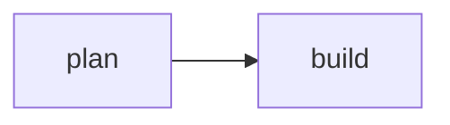
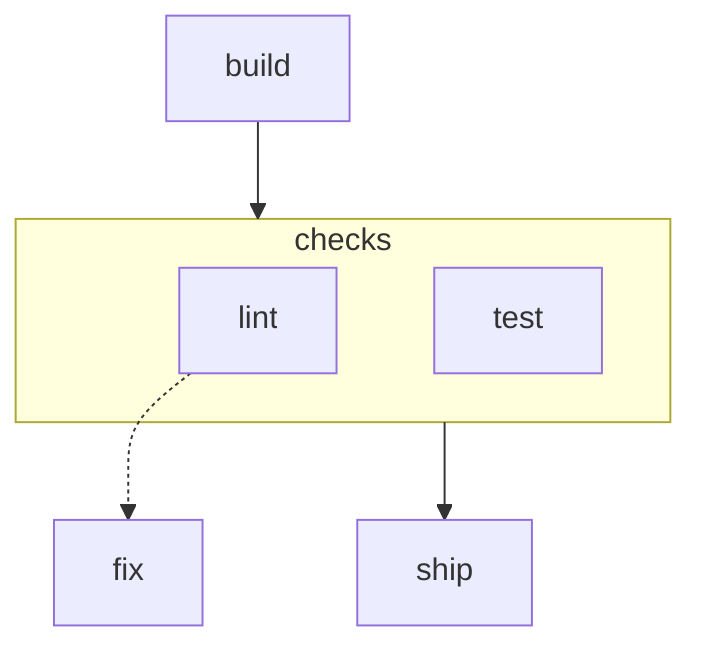

# plan: 4 tasks in 3 steps, 2 risks

## ◆ fragua (standard) · needs you · for 32m10s · 7E5PH4

approve-plan asks you to approve the plan before anything is built.

Then the run builds the change and checks what it built.

## what it found

- ✓ **git** commits as Ada \<ada@example.com>
- ▲ **forge** github acme/web, reachable
- ◌ **review** no fan-out review

> [!CAUTION]
> - A name with a newline in it breaks the line it is printed on.

- ▲ the budget sits under this workflow's usual spend
  - so: the run may stop before it finishes
  - fix: raise `limits.max_tokens_per_run`

## ✗ node `lint`: exit 101

```
line 1
line 2
line 3
```

whole output: `yunta status 7E5PH4 --node lint`

error: unused import  
  --> src/lib.rs:3:5

**error** node `fix`: unknown key `promt` for a `prompt` node  
at `.yunta/workflows/lint-fix.yaml:9:5`

```text
9 │     promt: "Fix what lint reported."
  │     ^^^^^
```

_help:_ did you mean `prompt`? · `yunta schema workflow` lists every key

**warning** the program `cargo-nextest` is not on this machine's PATH

**error:** no run is called `7E5PH5`; did you mean `7E5PH4`?  
_looked in ~/.yunta/runs_

- ✓ **2 healthy** claude-code 2.1.302 · git
- ▲ **first run** a new binary's first run takes 469 ms here, its next 2 ms
  - so: macOS assesses each new executable before its first run, and a suite pays that for every test binary it links again
  - fix: add the terminal that runs yunta under Developer Tools, then open it again
- ✗ **runners** none declared, and `lint-fix` needs one
  - fix: declare a runner in .yunta/config.yaml:

    ```
    runners:
      implementer:
        - { adapter: claude-code }
    ```

outside the declared globs:
- `src/main.rs`
- `Cargo.lock` (the lock file)

<details>

<summary><b>T001</b>: Make it</summary>

the file exists

</details>

A change **in Markdown**, with `code`.

- an item

```rust
fn main() {}
```





`src/lib.rs`: the change

```rust
pub fn greet() {}
```

_1 line_

`src/greet.rs › hello`: greets the person by name

```rust
pub fn hello({+name: &str+}) -> String;
```

_modified · 1 line_

`src/greet.rs › bye`: says goodbye

```rust
pub fn bye(name: &str) -> String;
```

_new · 1 line_

| step | task | |
|---|---|---|
| ● 1 | `cli-global` | Global and project flags |

| | node | | time | tokens |
|---|---|---|---|---|
| ✓ finished | `plan` | 4 tasks in 3 steps | 1m31s | 1.94M |
| ✓ finished | `approve-plan` | approved on its third round | 6h27m |  |
| ◌ never ran | ├─ `review` |  |  |  |
| ◌ never ran | └─ `conform` |  |  |  |
| ◌ never ran | `lint` ↺ fix-lint | sends a failure back at most once |  |  |

| | run | workflow | where it stands | |
|---|---|---|---|---|
| ◆ needs you | `EKPBGE` | fragua (standard) | implement asks at its terminal | 32m |
| ■ stopped | `60Y934` | fragua (quick) | stopped while it ran | `yunta resume 60Y934` |

| file | added | removed |
|---|---|---|
| `crates/cli/src/pack.rs` | +142 | −38 |
| `docs/notes.md` | +38 |  |

7 more files, +232 −49

a line a page composed itself

a row a pointer moves along, cut where it passes the edge it stands at  
the next row

| option | what it does | what happens | command |
|---|---|---|---|
| **approve** | builds the plan | its tasks run, a step at a time | `yunta resolve-gate 7E5PH4 approve` |
| **adjust** | Back to `plan` | the plan is written again with what you say<br>asks: what should change? | `yunta resolve-gate 7E5PH4 adjust --text "<answer>"` |

or

- `yunta close 7E5PH4`: closes it for good

| answer | on GitHub | what happens |
|---|---|---|
| **approve** | approve this pull request | the run goes on |
| **close** | close this pull request | nothing runs; this decision stays open |

on the machine that holds the run

- `yunta resume 7E5PH4`: reads the answer and acts on it

_the run holds its own state on disk._

- tokens: 20.2k spent

tokens per run                         2.00M  
spent                                  1.94M  
it wants more to review what it built

**next**

- `yunta status 7E5PH4`: where it stands

## on a screen

grill finished · brief finished · plan running · build never ran · review never ran · lint never ran · ship never ran

`↑↓` move · `enter` open · `n` new run · `x` close · `q` quit

◆ needs you: `yunta resolve-gate 7E5PH4 approve` (the plan waits for approval)

◆ needs you: the plan waits for approval · `a` go there

◆ **Q78GRR** needs you: the suite passed at baseline and now exits 101 · `a` go there

◆ needs you: node `implement` asks at its terminal

◆ **Q78GRR** needs you: node `grill` asks 3 questions: nothing is recorded until every one is answered

✓ Recorded: approve. On to `pr`.

◆ **gate `ship` needs a decision** · approve KQERFD

the change is reviewed and its findings settled

- ▸ **approve** On to `pr`: opens the pull request
- **abort** Pause here: nothing runs

then pr, then the run finishes

`↑↓` choose · `enter` answer · `esc` leave it waiting

**plan** · A32BZY · reviewed-plan · 2 tasks · needs you  approve-plan

Make it

you asked: a file the run is about

- the change
- ▸ 1 T001
- T002

**what it says**
- decided for you 2 `d`

**what weighs on it**
- the suite is red at baseline

**proof · T001** · step 1 of 1

tested by    the file exists  
**test -f made.txt**

◆ **Plan registered. Approve?**

`1` approve · `2` adjust · `3` abort

`tab` next place · `p` proof · `esc` leave it waiting

**What do you want to build?**

> _add support for installing a pack globally_

this becomes the brief; fragua asks before it decides for you

quick · ▸ **standard** · full

**What do you want to build?**

> add support

this becomes the brief; fragua asks only what it cannot decide for you

workflow

- ▸ **yunta/fragua** the full cycle: questions, plan, tests, work, review, PR
- **lint-fix** lint and format, with one fix round
- **run-tasks** a tasks document you wrote by hand

mode

▸ **quick** · standard · full

adapter

▸ **as the runners in config.yaml say** · claude-code · codex

what runs

grill never ran · plan never ran · review skipped · ship never ran

grill plan ship  
it stops for you at ship

This repository has never used yunta. Nothing is written until you say so.

## what this repository is

✓ **name** yunta  
✓ **language** rust  
✓ **suite** cargo test

## who does the work

✓ **planner** claude-code  
▸ ✓ **executor** ▸ claude-code  codex  
model:  
enter with none leaves it to the adapter  
✓ **mechanical** claude-code

write .yunta/config.yaml

- `yunta pack add https://github.com/eulke/yunta//packs/fragua@v0.0.5`
- `yunta init`

filter **n**

- **one-node** one command whose exit code is the check
- ▸ **lint-fix** a check, and an agent that fixes what it finds

`↑↓` choose · `enter` answer · `esc` take the first

_You never have to remember more than this._

- `/` anything: only what can be done here, with its command
- `n` start a new run, wherever no prompt stands
- `j k` move; the footer always says what they move
- `pgup pgdn` scroll the pane a page at a time
- `enter` open, answer, confirm
- `esc` one step back; what it leaves stays waiting
- `a` go to what needs you
- `f` follow what the run is doing
- `s g` what it cost, its graph
- `c` stop it and everything under it
- `o` the whole page, in a browser
- `q` go to the field; it keeps going
- `ctrl-c` leave: every run keeps going without this window

## ▸ lint-fix: a check, and an agent that fixes what it finds

- run: yunta run lint-fix

## tasks: a plan of tasks, and an agent that works through them

- run: yunta run tasks

- ✓ **acme/lint** v1.2.0 (3f9c2e1), as its lock records it
- ▸ ▲ **acme/review** v0.4.0 (91ab7d0), modified: its files no longer match its lock

- ✓ major: Global pack paths ignore the configured YUNTA_HOME
  - fixed: Global pack paths now use the shared user_state_root resolver, which honors YUNTA_HOME.
- ▸ ▲ major: **Global pack commands ignore the configured YUNTA_HOME state root**
- ◌ minor: Pack audit cannot inspect globally installed packs
- ✓ blocking: Pack target API shapes are defined outside the declared file
  - fixed: PackTarget and its path functions are now defined in crates/cli/src/pack.rs.

… 4 above  
search  global pack  
read    crates/cli/src/pack.rs  
read    crates/cli/src/commands/pack.rs  
read    crates/testkit/src/bin.rs  
edit    crates/cli/src/pack.rs  
edit    crates/cli/src/cli/pack.rs  
edit    crates/cli/src/commands/pack.rs  
edit    crates/cli/src/cli/dispatch.rs  
… 4 under

967k tokens ▃▂█▁▁▁▁▁▁▁▁▁▁▁▁ · 2m34s at work · 5m00s waiting on you

- progress: 12 of 15 nodes done, 1 reroute
- tokens: 26.1M in / 1.06M out (25M cached)
- time: 1h12m at work, 38m51s waiting on you
- slowest: implement 41m05s, spec 13m53s, plan 6m25s
- branch: yunta/run/...Q78GRR off main

_what you can do_

- `c` stop it and everything under it
- `s` what it cost
